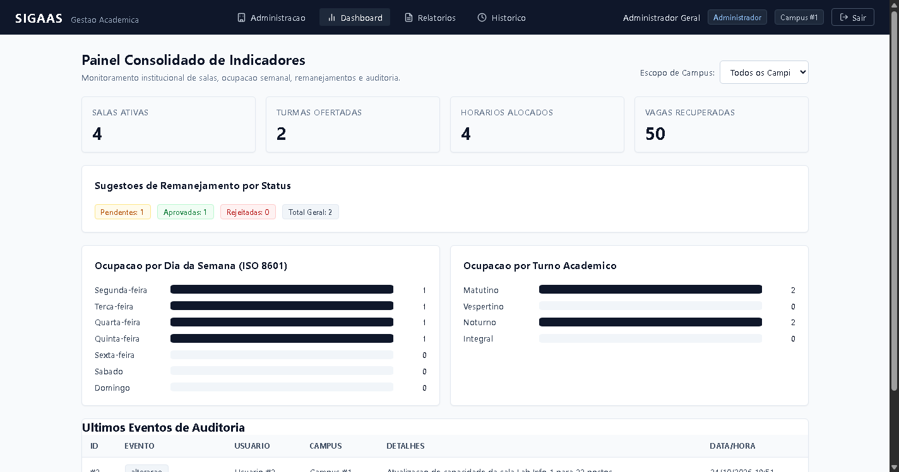
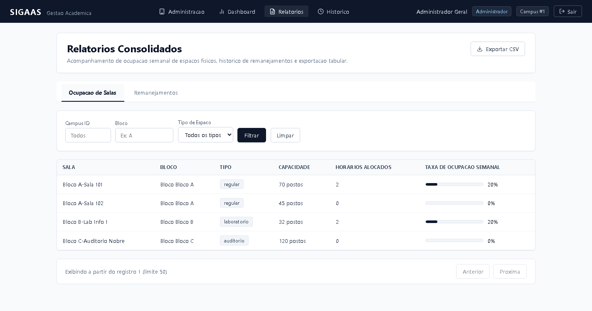
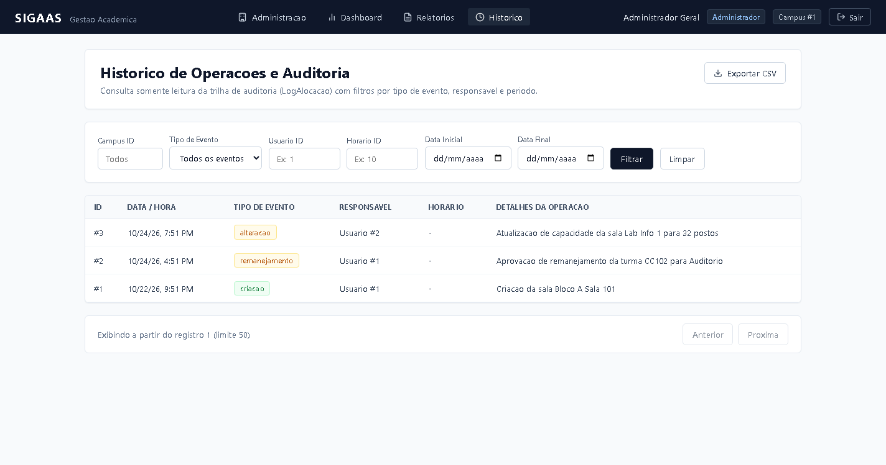

# Relatorio Tecnico: Sprint 07
## Sistema Inteligente de Gestao Academica e Alocacao de Salas (SIGAAS)
**Disciplina:** Fabrica de Software & Topicos Avancados em Computacao  
**Turma:** 8MB - CC  
**Equipe:** Grupo 31 - SIGAAS  
**Entrega:** Sprint 07 - Sistema Quase Completo (Dashboard, Relatorios, Filtros, Busca, Exportacao CSV e Auditoria)  
**Data-Limite de Entrega:** 25 de Outubro de 2026 as 23:59  
**Repositorio Oficial no GitHub:** [https://github.com/ValdVdC/Fabrica-de-Software-Gerenciador-de-salas](https://github.com/ValdVdC/Fabrica-de-Software-Gerenciador-de-salas)  

---

### 1. Identificacao da Equipe e Distribuicao de Papeis

| Integrante | Matricula | Papel no Squad | Responsabilidade Tecnica Principal |
| :--- | :---: | :--- | :--- |
| **Ewerton Thyago Tavares da Silva** | 01573977 | Scrum Master (Lider) | Facilitacao agil, governanca do ClickUp, protecao de branches e submissao no Teams |
| **Wesclei Batista Da Cruz Junior** | 01606772 | Product Owner | Validacao de requisitos de negocio, criterios de aceite Gherkin e especificacao SDD |
| **Osvaldo Vasconcelos de Carvalho** | 01614171 | Dev Backend / Sistemas | Endpoints FastAPI, servicos de agregacao SQL, streaming CSV e seguranca multi-tenant |
| **Gabriel Porfirio dos Santos** | 01591399 | Dev Frontend | SPA Angular 20, Dashboard com graficos SVG puros, telas de relatorios e signals |
| **Flavio Vecch de Brito Farias** | 01600988 | DBA & Documentacao | Migrations Alembic (`campus_id`), indices compostos, integridade relacional e relatorios |

---

# PARTE 7 - SPRINT 07: SISTEMA QUASE COMPLETO

## 7.1 Contexto e Objetivos da Sprint 07

A Sprint 07 representa o marco do **Sistema Quase Completo**, no qual o SIGAAS evolui de um conjunto de modulos funcionais integrados (CRUD, Motor C/OpenMP e IA preditiva de absenteismo) para uma solucao corporativa acabada de gestao academica. 

O foco central desta entrega foi expor, consolidar e permitir a exploracao analitica dos dados gerados por todas as camadas do sistema, atendendo rigorosamente as seis entregas obrigatorias do edital:
1. **Painel de Dashboard Institucional**: Visao executiva de ocupacao de salas, horarios, turmas e sugestoes de remanejamento.
2. **Relatorios Gerenciais Consolidados**: Relatorios detalhados de ocupacao fisica semanal e remanejamentos com calculo de taxas percentuais.
3. **Mecanismo de Pesquisa Textual Rapida (`q`)**: Localizacao imediata de salas, turmas e usuarios por termos parciais sem diferenciacao de maiusculas/minusculas.
4. **Filtros Combinados de Negocio**: Selecao precisa de horarios e espacos por dia da semana, turno, sala, campus e status.
5. **Exportacao Tabular de Dados em CSV**: Geracao autenticada de arquivos CSV via streaming HTTP para consumo em planilhas eletronicas.
6. **Historico de Operacoes e Trilha de Auditoria Unificada**: Rastreabilidade temporal completa de todas as criacoes, alteracoes, remocoes, alocacoes e remanejamentos executados no sistema.

---

## 7.2 Engenharia do Backend e Servicos de Agregacao (FastAPI)

Toda a camada de servicos da Sprint 07 foi construida aderindo a arquitetura em camadas (`Routers -> Services -> Queries/Models`), com validacao estrita por schemas Pydantic v2 e isolamento multi-tenant por campus:

### 7.2.1 Agregacoes de Dashboard sem N+1
- Endpoints `GET /api/v1/dashboard/resumo` e `GET /api/v1/dashboard/ocupacao`.
- Consultas agregadas executadas diretamente no PostgreSQL atraves de funcoes SQL nativas (`func.count`, `func.sum`, `group_by`), garantindo tempo de resposta constante e eliminando qualquer iteracao ou processamento de listas volumosas em memoria Python.
- Resumo executivo consolidando salas ativas, turmas ofertadas, horarios cadastrados, sugestoes por status (`pendente`, `aprovado`, `rejeitado`) e o indicador de vagas recuperadas em sala.
- Agregacao temporal de ocupacao por dia da semana no padrao normativo ISO 8601 (`0 = Segunda-feira` ate `6 = Domingo`) e distribuicao por turnos (`matutino`, `vespertino`, `noturno` e `integral`).

### 7.2.2 Relatorios e Exportacao em Streaming (CSV)
- Endpoints `GET /api/v1/relatorios/ocupacao-salas` e `GET /api/v1/relatorios/remanejamentos`.
- Calculo exato da **Taxa de Ocupacao Semanal (%)** de cada sala baseado na capacidade do espaco fisico e na quantidade de slots semanais alocados em relacao a grade disponivel.
- Suporte a exportacao tabular direta adicionando o parametro `formato=csv`.
- O servico `export_service.py` utiliza `StreamingResponse` do FastAPI com geradores Python assincronos, impedindo o esgotamento de memoria do servidor ao exportar relatorios extensos.
- Codificacao padronizada em UTF-8 com BOM (`\ufeff`), garantindo abertura automatica correta com acentuacao no Microsoft Excel, LibreOffice Calc e Google Sheets.
- **Protecao Ativa contra CSV Injection**: Higienizacao automatica de qualquer celula de texto cujo primeiro caractere seja `=`, `+`, `-` ou `@`, prefixando com apóstrofo (`'`) para anular a execucao maliciosa de formulas em planilhas de terceiros.
- Limite de seguranca maximo de 10.000 linhas por exportacao.

### 7.2.3 Busca Textual e Filtros Combinados
- Parametro de busca textual `q` implementado em `/api/v1/salas`, `/api/v1/turmas` e `/api/v1/usuarios`.
- Sanitizacao rigorosa de wildcards SQL: caracteres `%` e `_` fornecidos pelo usuario sao escapados como texto literal (`escape='\\'`), prevenindo ataques de negacao de servico (DoS) por consultas genericas pesadas.
- Filtros combinados no endpoint `/api/v1/horarios`: combinacao simultanea de `dia_semana`, `turno`, `sala_id` e `campus_id` validados por schemas Pydantic.

### 7.2.4 Trilha de Auditoria e Log Unificado
- Endpoint de leitura somente leitura: `GET /api/v1/logs` (metodos POST, PUT, DELETE retornam 405 Method Not Allowed).
- Centralizacao de registro atraves da funcao unificada `registrar_evento(db, tipo, usuario, campus_id, entidade, entidade_id, detalhes)`.
- Reutilizacao estruturada do enum `TipoEventoLog` (`criacao`, `alteracao`, `remanejamento`, `cancelamento`) com armazenamento de metadados em coluna JSON `snapshot_evento`.
- Isolamento multi-tenant por campus com BOLA/IDOR mitigado: coordenadores e secretarias consultam exclusivamente os logs de seu proprio campus; apenas administradores gerais possuem visibilidade transversal.

---

## 7.3 Evolucao do Banco de Dados e Migrations (Alembic)

Para suportar o isolamento multi-tenant na trilha de auditoria e otimizar as consultas de historico, foi aplicada uma migration oficial gerenciada pelo Alembic:

- **Identificacao da Migration**: `e4f1a2b3c4d5_adicionar_campus_id_log_alocacao.py`.
- **Alteracoes Estruturais**:
  - Inclusao da coluna `campus_id` (Integer, indexada) na tabela `log_alocacao`, configurada como Foreign Key referenciando `campus.id` com clausula `ON DELETE SET NULL`.
  - Script de backfill automatico executado durante o upgrade, recuperando retroativamente o `campus_id` dos logs legados a partir do vinculo com a tabela `horario`.
  - Criacao do indice composto `ix_log_alocacao_campus_timestamp` sobre as colunas `(campus_id, timestamp)`, otimizando buscas ordenadas no historico de eventos.
  - Procedimento de `downgrade()` compativel e reversivel para rollback seguro sem perda de integridade relacional.

---

## 7.4 Interface do Usuario e Experiencia SPA (Angular 20)

O frontend Angular recebeu os novos modulos mantendo conformidade estrita com o **Design System Institucional Anti-Vibe Coding**, livre de paletas neon, excessos visuais e emojis:

### 7.4.1 Dashboard Executivo (`DashboardComponent`)
- Painel de controle responsivo com cards KPI destacados (`salas_ativas`, `turmas`, `horarios` e `vagas_recuperadas`) formatados com fontes tabulares (`tabular-nums`).
- Resumo visual de sugestoes por status com badges semanticas neutras (`pendente`, `aprovado`, `rejeitado` e `total`).
- **Graficos de Barras em SVG Puro**: Implementados com tags nativas `<svg>` e CSS, sem a adicao de bibliotecas pesadas de terceiros (como Chart.js ou D3), garantindo performance maxima, peso minimo de bundle e estilizacao consistente com os tokens do sistema.
- Mapeamento estrito ISO 8601 para ocupacao semanal por dia e turnos academicos.
- Seletor de campus dinâmico visivel exclusivamente para perfil Administrador, com cancelamento automatico de requisicoes em voo (`Subscription.unsubscribe()`) ao alternar o escopo.

### 7.4.2 Relatorios e Exportacao (`RelatoriosComponent`)
- Estrutura com abas para navegacao rapida entre "Ocupacao de Salas" e "Remanejamentos".
- Barras de taxa percentual de ocupacao semanal renderizadas em CSS.
- Paginacao estruturada com limites padronizados (`limit = 50`) e navegacao por `skip`.
- Validacao temporal client-side com feedback imediato de erro caso a data final seja anterior a data inicial.
- Botao de exportacao CSV com desabilitacao reativa durante o download e tratamento de excecoes HTTP.

### 7.4.3 Historico de Auditoria e Filtros Rapidos (`HistoricoComponent`)
- Tabela corporativa de eventos com identificadores formatados, data/hora internacionalizada e badges de tipo de evento.
- Integracao de caixas de pesquisa rapida com icone de lupa SVG nas telas de Administracao e Secretaria, permitindo filtragem dinamica de salas, turmas e docentes.

### 7.4.4 Seguranca de Rotas e Navegacao Shell
- Rotas `/dashboard`, `/relatorios` e `/historico` registradas sob o `ShellComponent` e protegidas simultaneamente por `authGuard` e `roleGuard`.
- Acesso autorizado para `admin`, `coordenador` e `secretaria`, com redirecionamento automatico para perfis restritos (`professor` e `aluno`).
- Links de navegacao dedicados no Shell global acompanhados de icones vetoriais SVG sobrios (linhas de graficos, documento de relatorio e relogio de historico).

---

## 7.5 Evidencias Visuais das Funcionalidades em Operacao

As capturas abaixo foram geradas em ambiente de execucao real integrado, refletindo o design corporativo definitivo do SIGAAS:


*Figura 11 - Interface de autenticacao institucional do SIGAAS com design corporativo sobrio, campos ergonomicos de 48px e icones vetoriais SVG de seguranca.*


*Figura 14 - Cabecalho global do SIGAAS com identificacao de usuario logado, perfil formatado, campus de lotacao e navegacao para Dashboard, Relatorios e Historico.*


*Figura 15 - Painel executivo consolidado com indicadores principais (KPIs), badges de status de sugestoes, graficos de ocupacao em SVG nativo (ISO 8601 e turnos) e tabela de ultimos eventos.*


*Figura 16 - Relatorio de ocupacao fisica semanal com barras percentuais em CSS, filtros por bloco/tipo de sala, paginacao tabular e botao de exportacao autenticada em CSV.*


*Figura 17 - Historico completo de auditoria com rastreabilidade de eventos (criacao, alteracao, remanejamento), snapshot JSON e paginacao continua.*

---

## 7.6 Bateria de Testes Automatizados (TDD) e Metricas de Qualidade

A integridade do sistema foi assegurada por uma bateria massiva de testes unitarios e de integracao, executados com sucesso em ambiente local e na esteira de CI do GitHub Actions:

### 7.6.1 Testes de Backend (Pytest)
- **Total de Testes**: **202 testes automatizados** aprovados com 100% de sucesso.
- **Cobertura de Codigo**: **88.5% de cobertura global** (superando a meta de &ge; 85%).
- **Suites Validadas**:
  - `test_api_dashboard.py`: 10 testes cobrindo agregacoes, isolamento multi-tenant, filtro de campus e 403 para professor/aluno.
  - `test_api_relatorios.py`: 10 testes cobrindo calculo de ocupacao, filtros de periodo temporal, lista vazia e integridade de dados.
  - `test_export_service.py`: 14 testes cobrindo streaming CSV, codificacao UTF-8 com BOM, prevencao contra CSV injection e limites de linhas.
  - `test_api_busca_filtros.py`: 32 testes cobrindo busca `q` com caracteres literais (`%`, `_`), filtros combinados de horarios e validacoes de payload.
  - `test_api_logs.py`: 10 testes cobrindo paginacao, ordenacao decrescente por timestamp, isolamento BOLA/IDOR e bloqueio de gravacao (405).

```text
============================= test session starts =============================
platform win32 -- Python 3.12.3, pytest-9.0.3, pluggy-1.6.0
rootdir: C:\Work\workspace\SIGAAS
plugins: anyio-3.7.1, asyncio-0.21.1, cov-4.1.0
collected 202 items

backend/tests/test_academic_models.py ....                               [  1%]
backend/tests/test_api_alocacao.py ......                                [  4%]
backend/tests/test_api_busca_filtros.py ................................ [ 20%]
backend/tests/test_api_dashboard.py ..........                           [ 25%]
backend/tests/test_api_endpoints.py .........                            [ 30%]
backend/tests/test_api_logs.py ..........                                [ 35%]
backend/tests/test_api_motor.py ..                                       [ 36%]
backend/tests/test_api_relatorios.py ..........                          [ 41%]
backend/tests/test_api_sugestoes.py ...........                          [ 46%]
backend/tests/test_auth.py .............                                 [ 52%]
backend/tests/test_clickup_sync.py ..                                    [ 53%]
backend/tests/test_cursos_disciplinas.py ........                        [ 57%]
backend/tests/test_export_service.py ..............                      [ 64%]
backend/tests/test_health.py .....                                       [ 67%]
backend/tests/test_horarios_meus.py .........                            [ 71%]
backend/tests/test_ia_service.py ...............                         [ 79%]
backend/tests/test_log_service.py ....                                   [ 81%]
backend/tests/test_migrations.py ..                                      [ 82%]
backend/tests/test_models.py .....                                       [ 84%]
backend/tests/test_motor_c.py .......                                    [ 88%]
backend/tests/test_motor_service.py ..                                   [ 89%]
backend/tests/test_salas_admin.py ..............                         [ 96%]
backend/tests/test_turmas_matriculas.py ........                         [100%]

======================= 202 passed in 50.31s =======================
TOTAL COVERAGE: 88.5%
```

### 7.6.2 Testes de Frontend (Karma / Jasmine)
- **Total de Testes**: **150 testes unitarios** aprovados com 100% de sucesso e zero falhas/avisos.
- **Suites Validadas**:
  - `dashboard.service.spec.ts` e `dashboard.component.spec.ts`: Testes de requisicoes HTTP, gerenciamento de estado via Signals, mapeamento ISO 8601, renderizacao de SVGs e RBAC.
  - `relatorio.service.spec.ts` e `relatorios.component.spec.ts`: Testes de consulta paginada, validacao temporal de filtros e download de Blob CSV.
  - `log.service.spec.ts` e `historico.component.spec.ts`: Testes de trilha de auditoria e listagem de eventos.
  - `admin.service.spec.ts`, `secretaria.service.spec.ts` e `horario.service.spec.ts`: Testes de passagem de parametro `q` e filtros combinados.
  - `app.routes.spec.ts` e `role.guard.spec.ts`: Validacao de protecao de rotas para multiplos papeis e redirecionamento de seguranca.

```text
Chrome Headless 155.0.0.0 (Windows 10): Executed 150 of 150 SUCCESS (0.517 secs)
TOTAL: 150 SUCCESS
```

---

## 7.7 Governanca, Gestao de Tarefas e Metodologia Agil

A gestao da Sprint 07 seguiu com rigor absoluto o fluxo de trabalho integrado:
- **Spec-Driven Development (SDD)**: A especificacao `SPEC-007` foi previamente elaborada e aprovada no Gate 1 antes da escrita de qualquer codigo.
- **Sincronizacao ClickUp**: Todas as tarefas foram vinculadas ao espaco oficial do projeto no ClickUp atraves do script de integracao `clickup_sync.py`, sendo atualizadas em tempo real para os status `em progresso` e `concluido`.
- **Politica de Branches e PRs**: Utilizacao exclusiva de Trunk-Based Development com Squash and Merge mandatorio e auto-delete de branches. Todos os PRs foram submetidos com limite de diff estrito (&le; 400 linhas de codigo adicionadas).
- **Esteira de CI**: GitHub Rulesets aplicados com protecao da branch `main` e aprovacao obrigatoria de 5 checks simultaneos (Allocation Engine C, Backend Pytest, Code Quality & Policy Enforcement, Docker Smoke Test e Frontend Angular).

---

## 7.8 Conclusao e Proximos Passos (Sprint 08 e Banca Final)

Com o fechamento da Sprint 07, o SIGAAS atinge o status de **Sistema Quase Completo**, com todas as suas funcionalidades centrais implementadas, integradas, testadas e auditaveis. A combinacao de computacao de alto desempenho em C para resolucao de conflitos, aprendizado de maquina para otimizacao de espacos, trilha de auditoria persistida e uma SPA Angular moderna consolida o projeto com altissimo padrao de engenharia de software.

Para a Sprint 08 (Banca Final):
1. Gravacao dos videos academicos de demonstracao pratica do sistema e benchmarks de speedup sequencial vs. paralelo do Motor C.
2. Preparacao do roteiro de apresentacao executiva para os avaliadores.
3. Empacotamento final e publicacao da release de producao `v1.0.0`.
