# Manual do Usuario — SIGAAS

- **Sistema:** SIGAAS — Sistema Integrado de Gestao de Salas e Escalas com IA
- **Versao de Referencia:** `v1.0.0-rc.1`
- **Disciplina:** Fabrica de Software & Topicos Avancados em Computacao
- **Curso e Turma:** Curso de Bacharelado em Ciencia da Computacao — Turma 8MB - CC
- **Equipe:** Grupo 31 — SIGAAS
- **Data de Atualizacao:** 21/11/2026

---

## 1. Apresentacao e Objetivo do Sistema

O **SIGAAS** e uma aplicacao web desenvolvida para organizar a gestao academica e a alocacao de salas de aula em ambientes com um ou mais campi. Ele foi projetado para ser utilizado diretamente pelo navegador, sem exigir conhecimento tecnico de programacao ou banco de dados.

Com o SIGAAS, a equipe academica consegue:
- Manter o cadastro atualizado de **salas, blocos, capacidades e equipamentos** por campus;
- Gerenciar **cursos, disciplinas, turmas semestrais e matriculas** de alunos;
- Executar a **alocacao inteligente de turmas em salas**, respeitando capacidade e horarios sem conflitos;
- Analisar **sugestoes preditivas de remanejamento** geradas por Inteligencia Artificial para reduzir salas ociosas, sempre exigindo **aprovacao humana** antes de qualquer alteracao real;
- Consultar a **grade horaria semanal** personalizada para docentes e discentes;
- Acompanhar indicadores no **Dashboard**, exportar **Relatorios em CSV** e auditar todas as operacoes no **Historico**.

---

## 2. Publico-Alvo e Perfis de Acesso

O acesso as telas e acoes do SIGAAS e controlado automaticamente pelo perfil vinculado a conta do usuario. Cada usuario opera dentro do campus ao qual pertence, garantindo o isolamento de dados entre unidades. Apenas o perfil **Administrador** pode consultar indicadores, relatorios e historico consolidados de multiplos campi, bem como excluir salas e executar o benchmark cientifico.

| Perfil | Rotulo no Sistema | Telas Disponiveis na Navegacao | Principais Responsabilidades |
| :--- | :--- | :--- | :--- |
| **Admin** (`admin`) | Administrador | Administracao, Dashboard, Relatorios, Historico | Gerir salas (incluindo exclusao) e equipamentos, executar alocacao inteligente e benchmark cientifico, aprovar ou rejeitar sugestoes de remanejamento, acompanhar indicadores multi-campus e auditar logs. |
| **Coordenador** (`coordenador`) | Coordenador | Administracao, Dashboard, Relatorios, Historico | Cadastrar e editar salas e equipamentos, executar alocacao inteligente, decidir sugestoes de remanejamento IA, consultar indicadores e auditar logs do proprio campus (sem permissao na API para excluir salas ou rodar benchmark cientifico). |
| **Secretaria** (`secretaria`) | Secretaria | Secretaria Academica, Dashboard, Relatorios | Cadastrar cursos, disciplinas e turmas; efetivar e cancelar matriculas; consultar indicadores e exportar relatorios do proprio campus. |
| **Professor** (`professor`) | Docente | Grade Horaria | Consultar a grade semanal de aulas ministradas, blocos, salas alocadas, periodo letivo e turno. |
| **Aluno** (`aluno`) | Discente | Grade Horaria | Consultar a grade horaria individual, salas e docentes responsaveis, alem de acompanhar e cancelar matriculas ativas. |

---

## 3. Acesso, Autenticacao e Credenciais de Demonstracao

### 3.1 Como Acessar o Sistema

1. Abra o navegador web e acesse o endereco da aplicacao configurado no ambiente (em execucao local padrao, `http://localhost:4200` para a interface Angular integrada a API em `http://localhost:8000`).
2. Na tela **SIGAAS - Acesso ao Sistema** (`/login`), preencha os campos **Email Institucional** e **Senha**.
3. Clique no botao **Entrar**.
4. Apos a autenticacao, o sistema redireciona automaticamente para a pagina inicial do seu perfil (`/admin`, `/secretaria`, `/professor` ou `/aluno`).

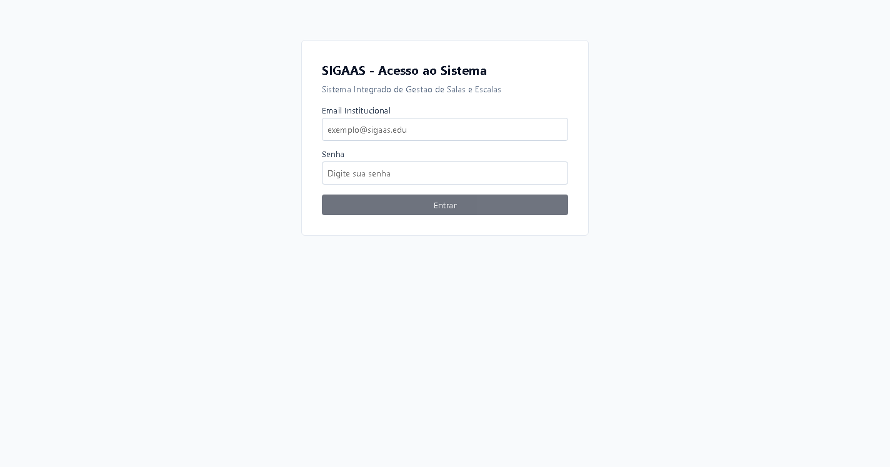

### 3.2 Encerramento de Sessao

No canto superior direito da barra de navegacao, sao exibidos seu nome, o cracha do seu perfil, o identificador do campus (`Campus #1`, por exemplo) e o botao **Sair**. Clique em **Sair** sempre que finalizar o uso em computadores compartilhados.

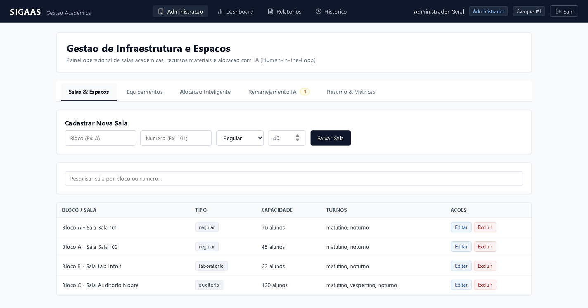

### 3.3 Credenciais de Demonstracao (`scripts/seed_db.py`)

Quando o ambiente de demonstracao e povoado com o script oficial `scripts/seed_db.py`, as contas abaixo ficam disponiveis para teste (todas com a senha padrao `sigaas123`):

| Perfil | Nome do Usuario | Email Institucional | Senha Padrao | Campus |
| :--- | :--- | :--- | :--- | :--- |
| Administrador | Admin Central | `admin@sigaas.edu` | `sigaas123` | Campus Central (`#1`) |
| Coordenador | Coord. Computacao | `coord.cc@sigaas.edu` | `sigaas123` | Campus Central (`#1`) |
| Secretaria | Secretaria Academica | `secretaria@sigaas.edu` | `sigaas123` | Campus Central (`#1`) |
| Professor (Docente) | Prof. Alan Turing | `alan.turing@sigaas.edu` | `sigaas123` | Campus Central (`#1`) |
| Professor (Docente) | Prof. Ada Lovelace | `ada.lovelace@sigaas.edu` | `sigaas123` | Campus Central (`#1`) |
| Professor (Docente) | Professor Padrao | `professor@sigaas.edu` | `sigaas123` | Campus Central (`#1`) |
| Aluno (Discente) | Aluno Joao Silva | `joao.silva@sigaas.edu` | `sigaas123` | Campus Central (`#1`) |
| Aluno (Discente) | Aluna Maria Souza | `maria.souza@sigaas.edu` | `sigaas123` | Campus Central (`#1`) |
| Aluno (Discente) | Aluno Padrao | `aluno@sigaas.edu` | `sigaas123` | Campus Central (`#1`) |

> **Observacoes:** As credenciais acima sao exclusivas para demonstracao, testes e avaliacao academica em ambiente local. No povoamento inicial, `alan.turing@sigaas.edu` e `ada.lovelace@sigaas.edu` ja possuem turmas e horarios alocados, enquanto `professor@sigaas.edu` inicia sem turmas vinculadas (grade vazia).

---

## 4. Visao Geral das Principais Telas

1. **Administracao (`/admin` — Gestao de Infraestrutura e Espacos):** organizada em cinco abas — `Salas & Espacos`, `Equipamentos`, `Alocacao Inteligente`, `Remanejamento IA` (com contador numerico de sugestoes pendentes) e `Resumo & Metricas`.
2. **Secretaria Academica (`/secretaria` — Gestao Academica e Secretaria):** organizada em cinco abas — `Cursos`, `Disciplinas`, `Turmas`, `Matriculas` e `Metricas`.
3. **Grade Horaria (`/professor` e `/aluno`):** exibe a grade semanal organizada por dia da semana, com cartoes contendo horario, codigo e nome da disciplina, bloco, numero e tipo da sala. No perfil **Discente**, a tela inclui abaixo a secao **Minhas Matriculas** com opcao de cancelamento.
4. **Dashboard (`/dashboard` — Painel Consolidado de Indicadores):** apresenta os quatro indicadores principais (`Salas Ativas`, `Turmas Ofertadas`, `Horarios Alocados` e `Vagas Recuperadas`), o resumo de sugestoes de remanejamento por status, os graficos de ocupacao por dia da semana e por turno e a tabela **Ultimos Eventos de Auditoria** (ate 10 registros recentes).
5. **Relatorios (`/relatorios` — Relatorios Consolidados):** oferece duas abas (`Ocupacao de Salas` e `Remanejamentos`), filtros combinados, paginacao (`Anterior` e `Proxima`) e botao **Exportar CSV**.
6. **Historico (`/historico` — Historico de Operacoes e Auditoria):** exibe a trilha somente leitura de todos os eventos registrados em `LogAlocacao` (`criacao`, `alteracao`, `remanejamento` e `cancelamento`), com filtros e exportacao em CSV.

> **Nota sobre as capturas de tela:** As imagens de `print_14` a `print_22` refletem o cabecalho e o layout consolidado da `v1.0.0-rc.1`. Algumas capturas ilustrativas de fluxos especificos (`print_03`, `print_04`, `print_09`, `print_12` e `print_13`) foram obtidas em sprints intermediarias e podem exibir o rotulo anterior no menu superior (`Infraestrutura & IA`) ou um subconjunto das abas atuais; os passos descritos neste manual correspondem a interface atual `v1.0.0-rc.1`.

---

## 5. Passo a Passo dos Fluxos Principais (Ponta a Ponta)

Esta secao descreve o uso completo do SIGAAS na ordem operacional natural, desde os cadastros basicos ate a auditoria final.

### 5.1 Fluxo 1 — Cadastros Basicos de Infraestrutura (Admin / Coordenador)

#### A. Cadastrar, pesquisar, editar e excluir salas
1. Acesse o menu **Administracao** e verifique se a aba **Salas & Espacos** esta selecionada.
2. No formulario **Cadastrar Nova Sala**, informe **Bloco** (ex.: `A`), **Numero** (ex.: `101`), **Tipo** (`Regular`, `Laboratorio`, `Auditorio` ou `Reuniao`) e **Capacidade** (entre `1` e `5000`). O cadastro pela interface atribui automaticamente disponibilidade para os turnos `matutino`, `vespertino` e `noturno`.
3. Clique em **Salvar Sala**. A nova sala aparece imediatamente na tabela abaixo.
4. Para localizar uma sala rapidamente, digite o bloco ou numero no campo **Pesquisar sala por bloco ou numero...**.
5. Para alterar dados, clique em **Editar** na linha da sala, ajuste os campos e clique em **Atualizar Sala** (ou **Cancelar** para desistir).
6. **Exclusao de sala (exclusiva para Administrador):** clique em **Excluir** em uma sala sem horarios vinculados. A remocao e imediata (sem janela de confirmacao). Usuarios com perfil **Coordenador** receberao erro de permissao (`403`) caso acionem esta operacao.

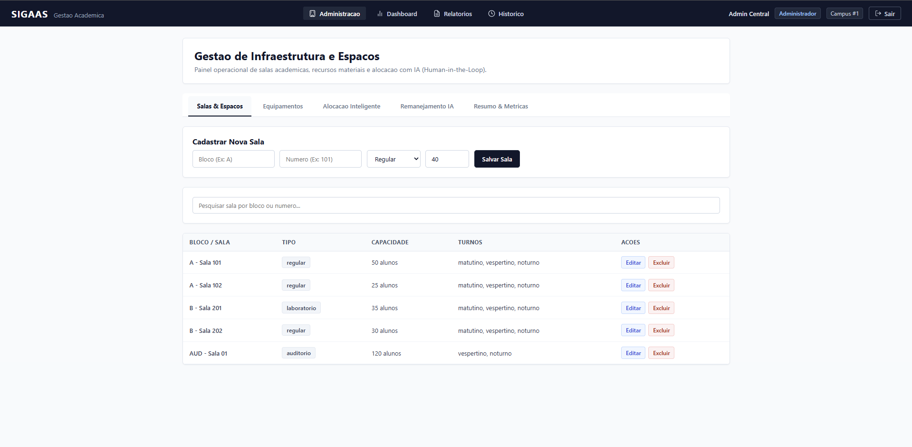

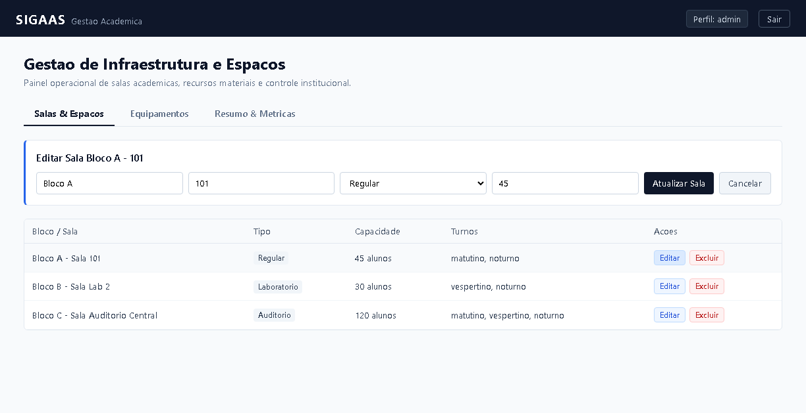

#### B. Cadastrar equipamentos e vincular a uma sala
1. Clique na aba **Equipamentos**.
2. Em **Novo Equipamento no Catalogo**, informe o **Nome** (ex.: `Projetor 4K`) e, opcionalmente, a **Descricao**. Clique em **Cadastrar Item**.
3. Em **Vincular Equipamento a Sala**, selecione a sala, escolha o equipamento, informe a quantidade (`Qtd`, de `1` a `1000`) e clique em **Vincular**. A tabela inferior exibe o catalogo geral de equipamentos cadastrados.

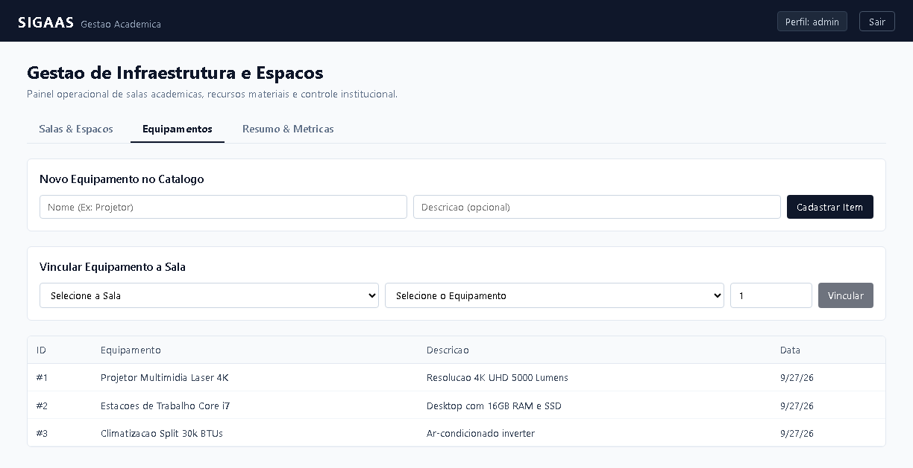

---

### 5.2 Fluxo 2 — Cadastros Academicos e Matriculas (Secretaria)

1. Acesse o menu **Secretaria Academica**.
2. **Cursos:** na aba **Cursos**, preencha o **Nome do Curso** e o **Codigo** (ex.: `CC`) e clique em **Salvar Curso**.
3. **Disciplinas:** na aba **Disciplinas**, selecione o curso, informe **Nome**, **Codigo** (ex.: `CC-101`) e **Carga Horaria (h)**, e clique em **Salvar Disciplina**.
4. **Turmas:** na aba **Turmas**, selecione a disciplina, informe o **Periodo** (ex.: `2026.1`), escolha o **Turno** (`Matutino`, `Vespertino`, `Noturno` ou `Integral`), informe opcionalmente o **ID Professor** e clique em **Criar Turma**. A tabela lista cada turma com `Disciplina #ID` e permite busca por texto ou filtro por disciplina.
5. **Matriculas:** na aba **Matriculas**, selecione a turma (`Turma #ID (periodo - turno)`), informe o **ID do Aluno** e clique em **Confirmar Matricula**.
   - *Observacao sobre IDs de usuarios:* Na versao `v1.0.0-rc.1`, as abas exibem os identificadores `#ID` de cursos, disciplinas e turmas, mas nao ha tela dedicada para listar IDs de alunos ou professores. Utilize o identificador numerico fornecido pela administracao tecnica (ou obtido via consulta autenticada a `GET /api/v1/usuarios`).
6. **Cancelamento de Matricula:** na listagem de matriculas com status `ativa`, clique em **Cancelar Matricula** para encerrar o vinculo e atualizar o total de matriculados da turma.

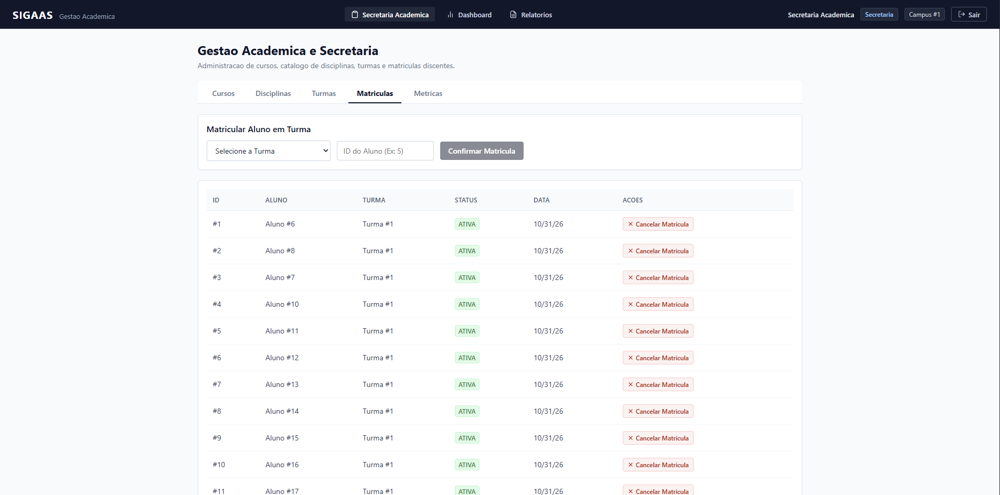

---

### 5.3 Fluxo 3 — Alocacao Inteligente de Salas (Admin / Coordenador)

Apos cadastrar salas e turmas, execute o motor de alocacao para distribuir automaticamente as turmas sem choques de horario e com menor desperdicio de vagas:

1. No menu **Administracao**, selecione a aba **Alocacao Inteligente**.
2. Preencha o campo **Periodo Letivo** (ex.: `2026.1`).
3. Em **Threads OpenMP**, escolha a configuracao de paralelismo (`1 Thread (Seq)`, `2 Threads`, `4 Threads` ou `8 Threads`).
4. Marque a caixa **Persistir no PostgreSQL** para gravar os horarios gerados no banco de dados (desmarque caso deseje apenas simular a distribuicao).
5. Clique em **Executar Alocacao Inteligente**.
6. **Benchmark Cientifico (exclusivo para Administrador):** clique em **Benchmark Cientifico** para comparar o tempo sequencial versus paralelo em carga de teste (Coordenadores recebem erro `403` na API para esta acao).
7. Analise os cartoes de resultado (**Speedup OpenMP**, **Eficiencia Computacional**, **Fracao Amdahl (f)**, **Tempos de Execucao** e **Alocacoes Concluidas**) e, ao executar a alocacao real, confira na tabela cada turma, sala alocada (ou `Sem Sala Disponivel` quando nao houver vaga/capacidade), dia da semana, horario e ociosidade em vagas.

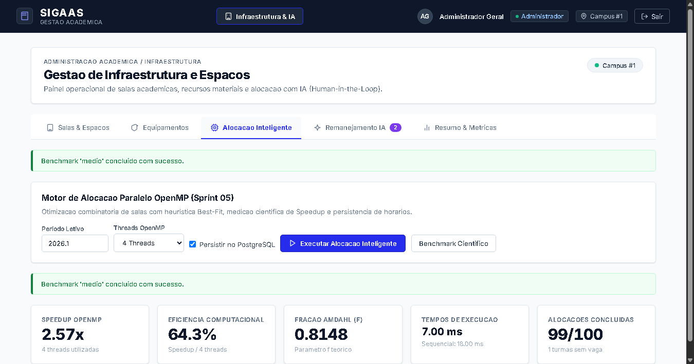

---

### 5.4 Fluxo 4 — Sugestoes Preditivas de IA e Aprovacao Humana (Admin / Coordenador)

O SIGAAS analisa o historico de frequencia para prever o absenteismo e identificar turmas com **ociosidade esperada igual ou superior a 40%** (e minimo de 10 vagas desperdicadas) alocadas em salas maiores do que o necessario. **Importante:** a IA nunca troca uma sala por conta propria; ela apenas cria sugestoes com status `pendente` para decisao humana.

1. No menu **Administracao**, abra a aba **Remanejamento IA**.
2. Clique em **Executar Analise IA** para rodar a avaliacao sobre as turmas do periodo ativo (o comando utiliza o **Periodo Letivo** configurado na aba **Alocacao Inteligente**, padrao `2026.1`; para analisar outro semestre, altere-o antes naquela aba). Voce tambem pode clicar em **Atualizar Lista** para recarregar sugestoes existentes.
3. Utilize o seletor de filtro (`Pendentes`, `Aprovadas`, `Rejeitadas` ou `Todas`) para organizar os cartoes.
4. Em cada cartao de sugestao pendente, avalie:
   - Percentual de risco de absenteismo e motivo apontado pela IA;
   - Comparativo entre **Sala Atual (Alocada)**, **Sala Recomendada (IA)** e **Otimizacao de Espaco** (vagas liberadas para o campus).
5. No campo **Parecer da Gestao Academica (Aprovacao Humana)**, registre a justificativa da decisao:
   - Clique em **Aprovar Troca** para efetivar a mudanca de sala no horario da turma e registrar o evento na auditoria;
   - Ou preencha a justificativa (obrigatoria neste caso) e clique em **Rejeitar** para manter a sala original.

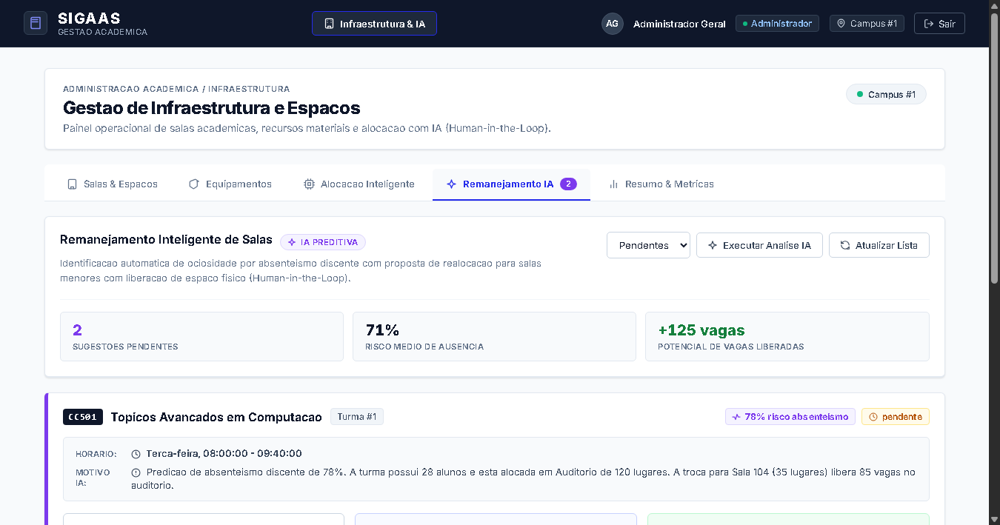

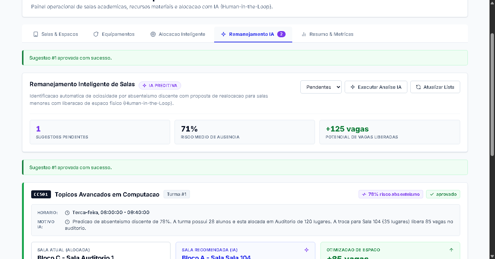

---

### 5.5 Fluxo 5 — Consulta a Grade Horaria (Professor e Aluno)

#### Perfil Docente (Professor)
1. Apos o login, o sistema abre o **Painel do Docente** (`/professor`).
2. Confira o resumo no topo (`Total de Aulas`, `Disciplinas` e `Perfil Ativo`) e os cartoes distribuidos por dia da semana, exibindo horario, codigo/nome da disciplina, bloco/sala, tipo de sala, periodo letivo e turno.
3. Clique em **Recarregar Grade** sempre que desejar buscar atualizacoes recentes de alocacao ou remanejamento.

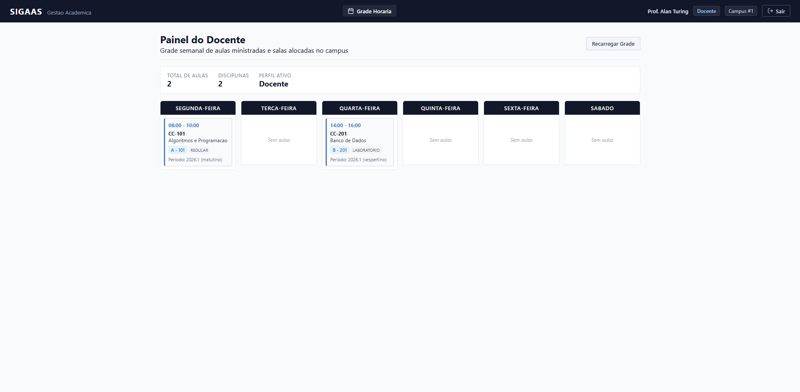

#### Perfil Discente (Aluno)
1. Apos o login, o sistema abre o **Painel do Discente** (`/aluno`).
2. Na parte superior, consulte sua grade semanal com horarios, salas e nome do docente responsavel por cada aula.
3. Na secao **Minhas Matriculas**, acompanhe o status de cada vinculo (`ativa` ou `cancelada`). Caso deseje desistir de uma turma, clique em **Cancelar Matricula**; a grade semanal sera atualizada automaticamente.

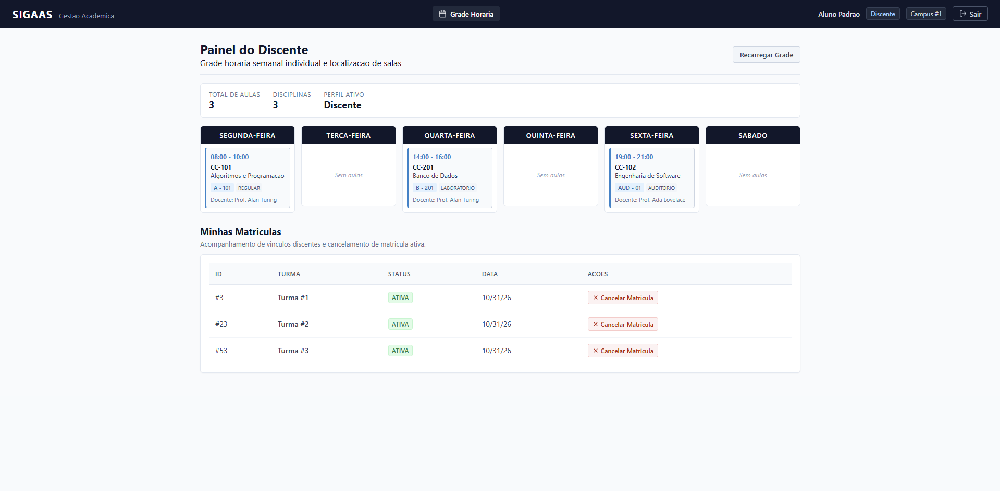

---

### 5.6 Fluxo 6 — Dashboard Consolidado e Relatorios CSV (Admin / Coordenador / Secretaria)

#### Dashboard
1. Clique em **Dashboard** no menu superior.
2. Se estiver autenticado como **Administrador**, utilize o seletor **Escopo de Campus** (`Todos os Campi`, `Campus #1`, `Campus #2` ou `Campus #3`) para filtrar os indicadores.
3. Acompanhe os cartoes de KPI (`Salas Ativas`, `Turmas Ofertadas`, `Horarios Alocados`, `Vagas Recuperadas`), o resumo de sugestoes por status, os graficos de barras de **Ocupacao por Dia da Semana** e **Ocupacao por Turno Academico** e a tabela **Ultimos Eventos de Auditoria**.

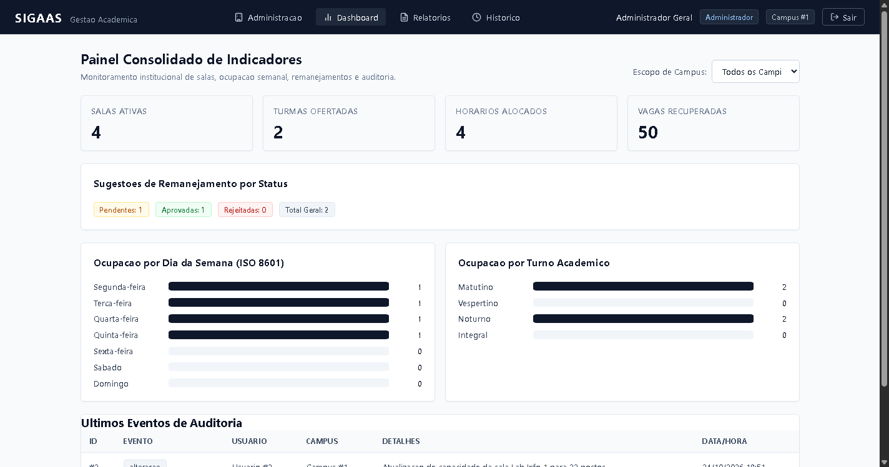

#### Relatorios e Exportacao CSV
1. Clique em **Relatorios** no menu superior.
2. Escolha a aba **Ocupacao de Salas** (filtros por Campus ID para Admin, Bloco e Tipo de Espaco) ou **Remanejamentos** (filtros por Campus ID para Admin, Status, Data Inicial e Data Final).
3. Clique em **Filtrar** para aplicar os criterios ou **Limpar** para redefinir a busca. Navegue entre paginas usando **Anterior** e **Proxima**.
4. Clique em **Exportar CSV** no canto superior direito para baixar o arquivo tabular correspondente a aba e aos filtros ativos.

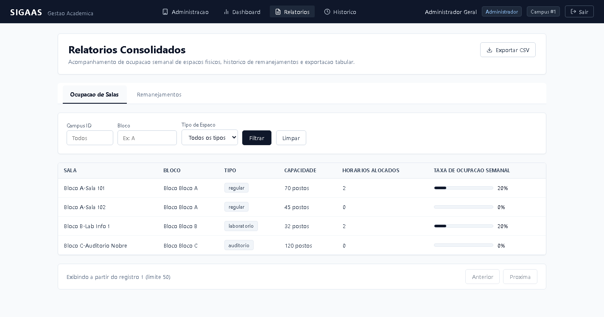

---

### 5.7 Fluxo 7 — Trilha de Auditoria e Historico (Admin / Coordenador)

1. Clique em **Historico** no menu superior (`/historico`).
2. Utilize os filtros disponiveis: **Campus ID** (exclusivo para Admin), **Tipo de Evento** (`Criacao`, `Alteracao`, `Remanejamento` ou `Cancelamento`), **Usuario ID**, **Horario ID**, **Data Inicial** e **Data Final**. Os identificadores de `Horario` e `Responsavel` exibidos na propria tabela podem ser reutilizados para refinar consultas especificas.
3. Clique em **Filtrar** para consultar os registros em ordem cronologica, com identificacao do responsavel, horario afetado e detalhes da operacao.
4. Para gerar evidencia documental ou analise externa, clique em **Exportar CSV**.

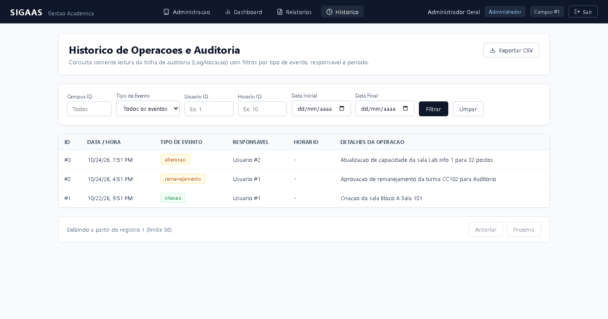

---

## 6. Mensagens, Validacoes e Situacoes Comuns de Uso

### 6.1 Validacoes de Formulario

- **Campos obrigatorios:** nos formularios de Login (`Entrar`), Secretaria (`Salvar Curso`, `Salvar Disciplina`, `Criar Turma`, `Confirmar Matricula`) e vinculo de equipamento (`Vincular`), o botao permanece desabilitado enquanto campos obrigatorios estiverem vazios. Em `Salvar Sala`, `Atualizar Sala` e `Cadastrar Item`, a validacao ocorre ao enviar o formulario.
- **Capacidade de salas e quantidades:** a capacidade de uma sala deve ser um numero inteiro entre `1` e `5000`; a quantidade de equipamentos vinculados deve estar entre `1` e `1000`.
- **Intervalo de datas (Relatorios e Historico):** a **Data Inicial** nao pode ser posterior a **Data Final**. Caso ocorra inversao, um alerta de validacao e exibido antes da consulta.
- **Rejeicao de sugestao da IA:** o botao **Rejeitar** so e habilitado apos preencher o campo de justificativa, garantindo rastreabilidade da decisao humana.

### 6.2 Erros Comuns e Como Proceder

| Situacao / Codigo | O que Acontece na Tela | Causa Provavel | Como Resolver |
| :--- | :--- | :--- | :--- |
| **Sessao Expirada (`401`)** | A sessao e encerrada automaticamente e o usuario volta para `/login`. | O token de autenticacao expirou ou ficou invalido. | Informe novamente seu email institucional e senha na tela de login. |
| **Acesso Restrito (`403`)** | Banner vermelho no topo com a mensagem `Acesso restrito: rota exclusiva para perfis autorizados.` (ou detalhe da API) e botao `Fechar`. | Tentativa de acessar rota ou acao exclusiva de outro perfil (ex.: Coordenador tentando excluir sala ou rodar benchmark) ou de outro campus. | Utilize apenas as opcoes permitidas ao seu perfil ou contate um Administrador. |
| **Conflito de Dados (`409`)** | Alerta vermelho na tela ativa descrevendo o conflito. | Sala ja cadastrada com mesmo bloco e numero no campus, tentativa de excluir sala com horarios vinculados, aluno ja matriculado na turma ou choque de horario na aprovacao de remanejamento. | Verifique os registros existentes na tabela antes de salvar, remova horarios vinculados antes de excluir uma sala ou escolha outra sala/horario disponivel. |
| **Credenciais Invalidas (`401` no Login)** | Alerta vermelho na tela de login exibindo `Credenciais invalidas` (ou o aviso padrao `Falha na autenticacao. Verifique suas credenciais.`). | Email ou senha digitados incorretamente. | Confira letras maiusculas/minusculas e tente novamente. |
| **Dados Nao Encontrados (`404`) ou Invalidos (`422`)** | Alerta vermelho indicando campo invalido ou registro inexistente. | ID de aluno, professor, turma ou recurso inexistente no campus atual, ou campo fora do formato esperado. | Confira o ID de cursos, disciplinas e turmas nas tabelas da Secretaria ou confirme o ID de usuario com a administracao tecnica. |

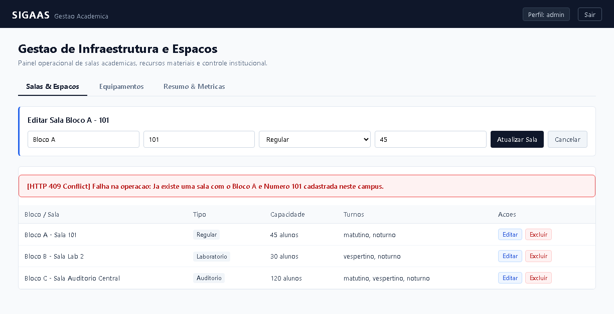

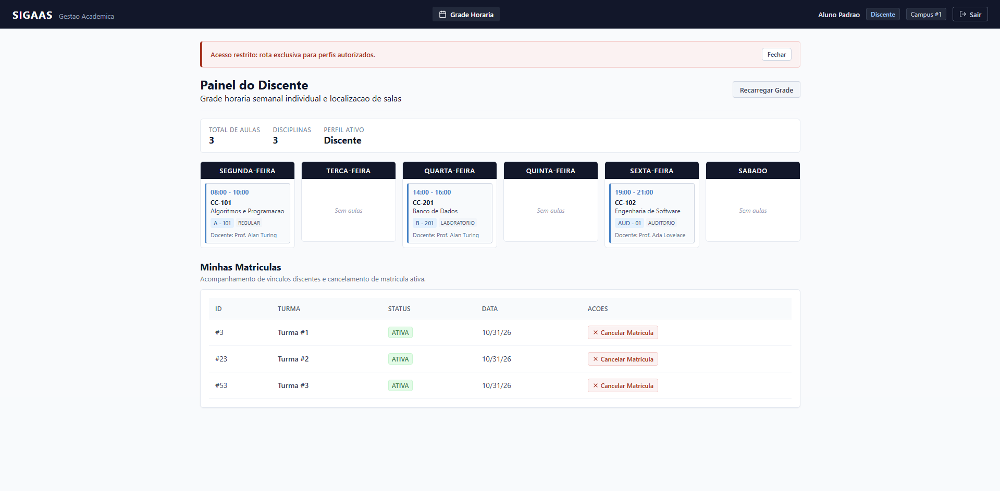

### 6.3 Perguntas Rapidas sobre Situacoes Cotidianas

- **Minha grade horaria aparece vazia (`Nenhum horario alocado para esta grade semanal.`):** verifique com a Secretaria se sua matricula (aluno) ou atribuicao de turma (professor) esta ativa e confirme com a Coordenacao se a alocacao inteligente ja foi executada com a opcao **Persistir no PostgreSQL** marcada.
- **Uma turma apareceu como `Sem Sala Disponivel` na Alocacao Inteligente:** nao havia sala livre no campus com capacidade suficiente para o numero de matriculados naquele turno/horario. Cadastre ou amplie uma sala compativel e execute a alocacao novamente.
- **Nenhuma sugestao aparece na aba Remanejamento IA:** altere o filtro para `Todas` para conferir decisoes anteriores, confirme o **Periodo Letivo** na aba **Alocacao Inteligente** e clique em **Executar Analise IA**.
- **Nao consigo excluir uma sala:** apenas o perfil **Administrador** possui permissao para exclusao, e o sistema impede remover salas que possuam horarios alocados (erro `409`).
- **Nao consigo ver dados de outro campus:** por regra de seguranca multi-campus, apenas o perfil **Administrador** visualiza dados consolidados de outros campi; Coordenadores, Secretaria, Professores e Alunos visualizam exclusivamente o proprio campus.
